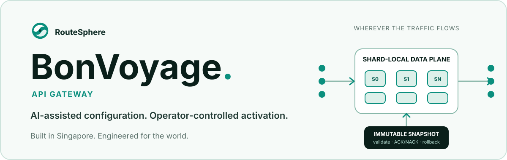
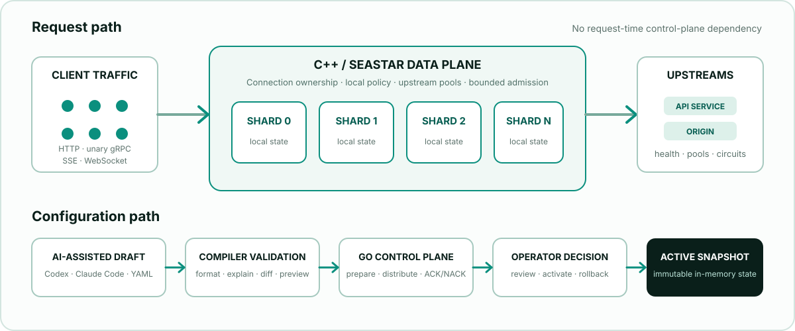

<p align="center">
  <picture>
    <source media="(prefers-color-scheme: dark)" srcset=".github/readme/bonvoyage-hero-dark.svg">
    <source media="(prefers-color-scheme: light)" srcset=".github/readme/bonvoyage-hero-light.svg">
    
  </picture>
</p>

<p align="center">
  <a href="https://github.com/routesphere-global/bonvoyage/releases/latest"></a>
  <a href="LICENSE"></a>
  <a href="https://github.com/routesphere-global/bonvoyage/actions/workflows/ci.yml"></a>
  <a href="https://docs.routesphere.global/"></a>
  <a href="https://routesphere.global/release-evidence/"></a>
</p>

<p align="center">
  <a href="https://routesphere.global/"><strong>Website</strong></a>
  &nbsp;&middot;&nbsp;
  <a href="https://docs.routesphere.global/getting-started/quickstart/"><strong>Quickstart</strong></a>
  &nbsp;&middot;&nbsp;
  <a href="https://docs.routesphere.global/"><strong>Documentation</strong></a>
  &nbsp;&middot;&nbsp;
  <a href="https://routesphere.global/performance/"><strong>Performance</strong></a>
  &nbsp;&middot;&nbsp;
  <a href="https://routesphere.global/release-evidence/"><strong>Release evidence</strong></a>
</p>

# BonVoyage API Gateway

BonVoyage is an Apache-2.0 reverse proxy and API gateway that routes, secures,
and observes API traffic on infrastructure you control. Its C++/Seastar data
plane owns request work shard-locally, while a separate Go control plane
validates and activates immutable configuration snapshots without sitting in
the request path.

It is **AI-native and operator-controlled**: release-matched Codex and Claude
Code skills can help engineers understand, draft, and migrate configuration;
deterministic tools validate the candidate; the operator decides what becomes
active.

> **Current release:** [BonVoyage v1.0.4](https://github.com/routesphere-global/bonvoyage/releases/tag/v1.0.4)
> is the current checksum-bound Apache-2.0 release. Use the exact packages,
> checksums, signatures, provenance, SBOMs, and platform scope attached to that
> release rather than an unverified local or third-party build.

## Quick start

Prerequisites: Docker with Compose v2 and enough local resources to build the
Seastar data plane.

```bash
docker compose -f deploy/compose/local.yml up --build --detach --wait
make verify-local-deployment
```

The evaluation profile binds traffic, metrics, and admin listeners to host
loopback. The verifier checks snapshot compilation, gateway and upstream
lifecycle, fixed and proxied traffic, exact request-accounting deltas,
configuration gauges, restart counts, and selected failure counters. A passing
run ends with:

```text
status=pass
```

Probe the fixed readiness route directly:

```bash
curl --fail --show-error http://127.0.0.1:8080/bonvoyage/ready
```

Stop and remove the local stack:

```bash
docker compose -f deploy/compose/local.yml down --volumes
```

Read the complete [Docker quickstart](https://docs.routesphere.global/getting-started/quickstart/)
and [local verification guide](https://docs.routesphere.global/how-to/verify-local-deployment/).

## Why BonVoyage

- **Shard-local execution.** Connections, request state, upstream pools, and
  fast-path policy remain local to their owning Seastar shard.
- **Deterministic change.** Configuration is compiled and validated before
  activation, with explicit ACK/NACK outcomes, last-known-good service, and
  rollback primitives.
- **Bounded failure behavior.** Admission, retries, circuits, queues, timeouts,
  and telemetry are designed with explicit resource and recovery limits.
- **Inspectable releases.** Signed artifacts, SBOMs, provenance, replay
  records, security checks, and scoped performance evidence accompany the
  published software boundary.
- **No RouteSphere account required.** The Apache-2.0 gateway runs without
  registration, a subscription, or a request-time RouteSphere service.

## How it works

<p align="center">
  <picture>
    <source media="(prefers-color-scheme: dark)" srcset=".github/readme/bonvoyage-architecture-dark.svg">
    <source media="(prefers-color-scheme: light)" srcset=".github/readme/bonvoyage-architecture-light.svg">
    
  </picture>
</p>

**Request:** client traffic -> owning data-plane shard -> selected upstream.

**Configuration:** assisted draft -> deterministic validation -> prepare and
ACK/NACK -> operator activation -> active immutable snapshot.

The active data plane serves traffic from immutable in-memory state. The
control plane and offline tools prepare, validate, preview, and distribute
candidate snapshots. Invalid candidates are rejected without replacing the
active configuration.

## What ships in v1.0.4

| Area | Released capability |
| --- | --- |
| Protocols | HTTP/1.1 and HTTP/2 proxying, unary gRPC, HTTP/1.1 WebSocket forwarding, and incremental SSE delivery |
| Traffic | Host/path/header routing, upstream pools, weighted load balancing, health checks, bounded retries, endpoint circuits, timeouts, and overload admission |
| Security and policy | TLS and mTLS boundaries, API-key and JWT admission, source-IP policy, CORS, request-content controls, redirects, transformations, rewrites, and local rate limits |
| Configuration | Immutable snapshot compilation, validation, preview, ACK/NACK discovery, activation, and rollback primitives |
| Observability | Prometheus metrics, bounded asynchronous access logging, decision telemetry, and OpenTelemetry trace export |
| Deployment | Docker Compose, native Ubuntu packages, Kubernetes manifests, benchmark tooling, security checks, and plan-first Linux host tuning |
| Authoring tools | Release-matched `validate`, `format`, `explain`, `diff`, `migrate`, and `preview` commands with deterministic machine output |

See the authoritative [supported-capability boundary](https://docs.routesphere.global/reference/supported-capabilities/)
before designing a production evaluation.

## Tail latency at 600,000 offered RPS

BonVoyage met the `p99 <= 500 ms` target in 3 of 3 measured runs. NGINX met it
in 1 of 3. The published post-release replay used a bounded HTTPS/1.1
header-transformation workload on shared AWS infrastructure. Across all three
runs per system, 216 million requests returned HTTP 200 with zero client errors
and zero timeouts.

| Metric | BonVoyage v1.0.4 | NGINX 1.30.4 |
| --- | ---: | ---: |
| Three-run median successful RPS | 599,899.2 | 599,787.9 |
| Runs meeting the `p99 <= 500 ms` gate | 3 of 3 | 1 of 3 |
| p99 | 189.934 ms | 745.333 ms |
| RSS | 643.2 MiB | 959.0 MiB |
| Application CPU | 22.66 core-equivalents | 16.92 core-equivalents |

This was a fixed offered-rate diagnostic on shared AWS infrastructure, not a
maximum-capacity result or a universal superiority claim. BonVoyage used more
measured application CPU while maintaining the stated tail gate and using less
RSS and fewer descriptors in this workload. Read the
[complete replay, environment, run order, limitations, and rejected results](https://docs.routesphere.global/performance/v1-0-4-post-release-replay/).

## AI-native, operator-controlled

BonVoyage includes release-matched configuration skills and deterministic
authoring tools. The intended workflow is:

1. An engineer or assistant drafts or migrates a candidate configuration.
2. Release-matched tooling formats, explains, validates, and previews it.
3. The control plane prepares the immutable snapshot and reports ACK or NACK.
4. An accountable operator chooses whether to activate or roll back.

The skills do not bypass validation, grant an assistant production authority,
or turn v1.0.4 into a general AI, MCP, or inference-governance gateway. Review
the [assistant skill contract](https://docs.routesphere.global/reference/assistant-skill-contract/)
and [published evaluations](https://docs.routesphere.global/reference/assistant-skill-evaluations/).

## Operating surfaces and product boundary

The gateway and included Go control-plane source run without a RouteSphere
account, product registration, subscription, or hosted RouteSphere dependency.
The data plane can start from and continue serving its active immutable
snapshot when the control-plane process is unavailable.

Console Free is an optional, no-cost proprietary companion distributed as a
release-matched binary package when one is admitted for a release. YAML,
release-matched configuration tools, and Console Free are the supported public
operating surfaces.

The Console's management service is not a public compatibility contract. This
repository does not ship a supported external management API, SDK, or
third-party Console integration guide. Supported programmatic fleet management
is reserved for the future Enterprise offer. See
[Get Console Free](https://docs.routesphere.global/console/get-console-free/)
for its package and licensing boundary.

## Release status

| Area | Status |
| --- | --- |
| Release | [v1.0.4 published](https://github.com/routesphere-global/bonvoyage/releases/tag/v1.0.4) with exact assets and evidence |
| License | Apache License 2.0 for BonVoyage-owned source and public documentation |
| Support | Community issue intake; no human-response or incident-response SLA |
| Data plane | Included in v1.0.4 within the documented protocol and policy boundaries |
| Go control plane | Included as source in v1.0.4; not in the request path |
| Performance evidence | Scoped results with exact workload and environment boundaries |
| Console | Proprietary source not included; Console Free is an optional release-matched package |
| Enterprise | Private and unreleased; no public availability claim |

## Development checks

Install the pinned JavaScript tooling and run the portable contract suites:

```bash
make dependencies
make test
make config-authoring-corpus-test
make config-authoring-cross-surface-contract-test
make config-authoring-completion-test
make config-authoring-snippets-test
make config-authoring-reason-codes-test
make config-authoring-skill-contract-test
make config-authoring-skill-evaluations-test
make oss-deb-builder-test
```

Linux/Seastar builds, sanitizers, protocol conformance, fuzzing, and release
artifact checks require Docker or an Ubuntu 24.04 x86-64 host. Required checks
fail when their tools are unavailable; they do not report a skipped check as
success.

## Documentation

- [Requirements](https://docs.routesphere.global/getting-started/requirements/)
- [Docker quickstart](https://docs.routesphere.global/getting-started/quickstart/)
- [Configuration authoring](https://docs.routesphere.global/reference/configuration-authoring-contract/)
- [System model](https://docs.routesphere.global/concepts/system-model/)
- [Supported capabilities](https://docs.routesphere.global/reference/supported-capabilities/)
- [Network ports and firewall rules](https://docs.routesphere.global/reference/network-ports/)
- [Performance evidence](https://routesphere.global/performance/)
- [Release evidence](https://routesphere.global/release-evidence/)
- [Support and security](https://docs.routesphere.global/reference/support-and-security/)

## Support and security

- Community questions and reproducible defects: use this repository's issue
  tracker.
- Suspected vulnerabilities: follow [SECURITY.md](SECURITY.md) and use private
  vulnerability reporting. Do not publish sensitive reports in an issue.
- Verified Release Assurance inquiries: <sales@routesphere.global>

Community issue submission does not include a response or incident-resolution
SLA. Read [SUPPORT.md](SUPPORT.md) before sharing diagnostics.

## License and trademarks

BonVoyage-owned source and public documentation are licensed under the
[Apache License 2.0](LICENSE). Third-party material remains under its identified
upstream terms; consult the
[third-party notices](packaging/release/licenses/THIRD_PARTY_NOTICES.md),
[source-availability notice](packaging/release/licenses/THIRD_PARTY_SOURCE.md),
`third_party/`, dependency records, and release artifacts before
redistribution.

Community participation is issue-based as described in
[CONTRIBUTING.md](CONTRIBUTING.md); external source-code fixes and pull requests
are not accepted at this stage. Maintainer commits use
[Developer Certificate of Origin 1.1](DCO) sign-off. The Apache license does
not grant general rights to RouteSphere or BonVoyage names and logos; see the
[trademark policy](TRADEMARKS.md).

## Project policies

[License](LICENSE) &middot;
[Trademarks](TRADEMARKS.md) &middot;
[DCO](DCO) &middot;
[Contributing](CONTRIBUTING.md) &middot;
[Dependency policy](DEPENDENCY_POLICY.md) &middot;
[Release verification](packaging/release/README.md) &middot;
[Governance](GOVERNANCE.md) &middot;
[Security](SECURITY.md) &middot;
[Support](SUPPORT.md) &middot;
[Code of Conduct](CODE_OF_CONDUCT.md)
