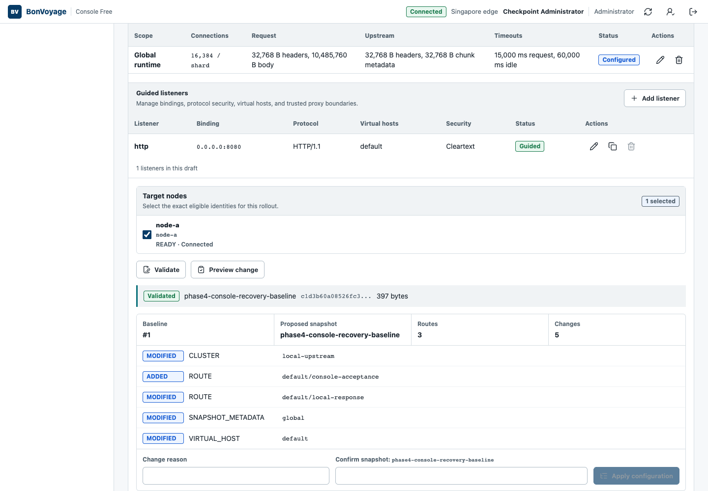

This procedure requires an Operator or Administrator account. Begin only after
[confirming the installation baseline](../sign-in-and-inspect/).

## 1. Prepare the draft

Open **Configuration**. The YAML editor contains a complete desired-state
document; guided editors update that same document. Review the proposed
snapshot ID and generation, make one bounded change, and select the exact target
nodes.

Do not paste private keys, API keys, JWTs, or certificate contents into the
document. TLS fields refer to secret filenames installed on the gateway.

## 2. Validate and preview

Select **Validate**. Continue only when the result identifies the proposed
snapshot as valid. Select **Preview change** and review every added, modified,
and removed resource.



The preview is deliberately separate from activation. Confirm that:

- the baseline is still the rollout you inspected;
- the proposed snapshot ID is unique and intentional;
- the selected nodes are correct;
- no unrelated resource appears in the change list; and
- listener changes that require process replacement are scheduled as a
  controlled restart rather than assumed to be live-safe.

## 3. Apply the immutable artifact

Enter a concise **Change reason**. Type the generated snapshot confirmation
value exactly, then select **Apply configuration**.

The button remains unavailable until validation, preview, reason, confirmation,
and target selection are complete.

## 4. Observe delivery

Open **Rollouts**. A successful rollout reaches **ACTIVE** after the target node
ACKs the artifact. A rejected rollout reaches **CANCELLED** or **FAILED** and
retains structured diagnostics; it does not silently replace the active
last-known-good snapshot.

## 5. Prove runtime behavior

Exercise the route or policy that changed. For example:

```bash
curl --fail --show-error http://GATEWAY_ADDRESS:GATEWAY_PORT/bonvoyage/ready
```

Use the real gateway address and the expected route for your change. Compare the
status, body, headers, and metrics with the reviewed proposal. Finally, open
**Audit** and correlate the actor, reason, operation ID, rollout sequence,
target node, and outcome.

If the node NACKs the artifact, continue with
[Recover a rejected rollout](../recover-rejected-rollout/).
