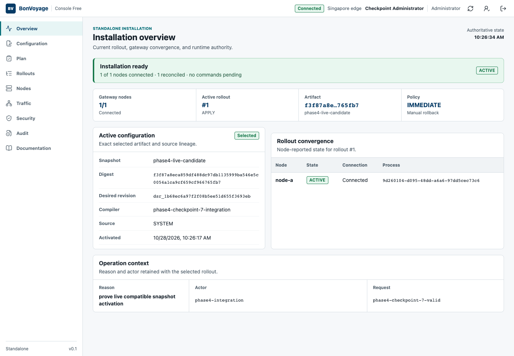

Console Free is the no-cost visual companion for a standalone BonVoyage
installation. It presents the same desired state, immutable rollout identity,
node reports, diagnostics, and audit history exposed by the management plane.
The Console is optional: the OSS gateway, configuration tools, and Admin API do
not require it.

:::note[Current scope]
Console Free is distributed separately from the public source repository. These
pages document supported operator behavior without publishing Console source,
credentials, or private management internals.
:::

## The operating loop

Every change follows one visible loop:

1. Confirm that the installation and intended gateway nodes are ready.
2. Edit the complete desired-state YAML, directly or with a guided editor.
3. Validate the document and preview the exact resource changes.
4. Supply an operator reason and the generated confirmation value.
5. Apply the immutable artifact to the selected nodes.
6. Observe an ACK or NACK, verify live traffic, and inspect the audit record.
7. Correct the proposal or restore retained last-known-good bytes when needed.

The green **Installation ready** state means the selected control plane has a
connected, reconciled gateway and no command is pending. It does not by itself
prove that a particular route or policy behaves correctly; complete the traffic
check documented for that change.

## Roles

| Role | Intended use |
| --- | --- |
| Auditor | Read installation state, rollouts, traffic summaries, security state, and audit history. |
| Operator | Propose, validate, preview, and apply ordinary configuration changes. |
| Administrator | Perform protected account, node-lifecycle, recovery, and other consequential operations. |

Protected mutations may require reauthentication even when the account is
already signed in.

## Start here

1. [Create the first administrator](create-first-administrator/).
2. [Sign in and inspect the installation](sign-in-and-inspect/).
3. [Apply a configuration safely](apply-configuration/).
4. [Recover a rejected rollout](recover-rejected-rollout/).

Use the **Documentation** entry in the Console sidebar to open this
release-matched section in a separate browser tab.
