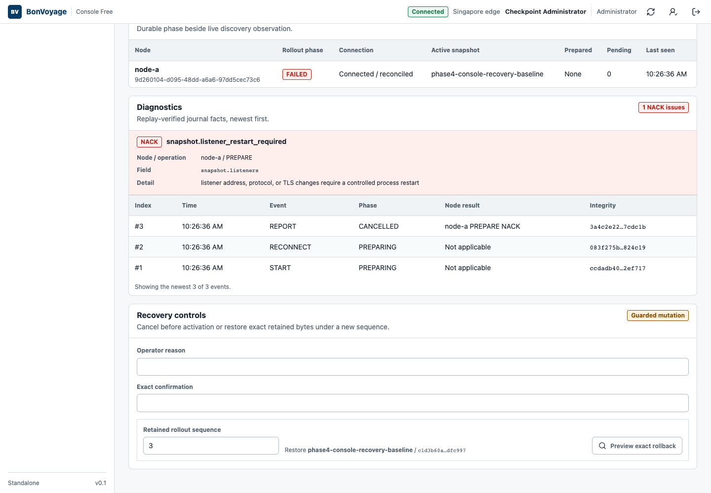
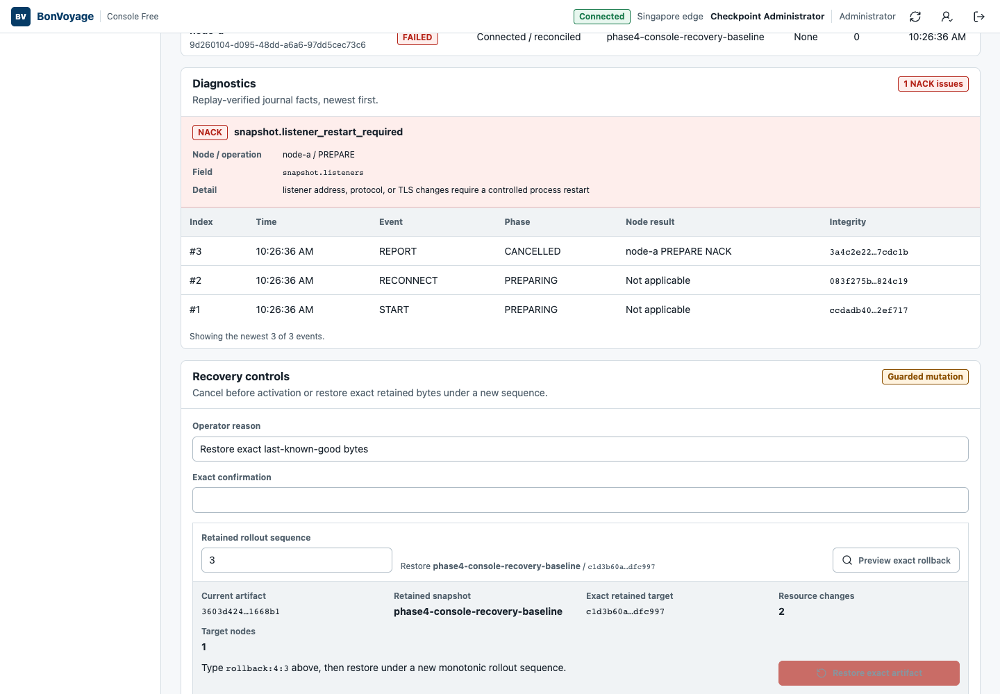
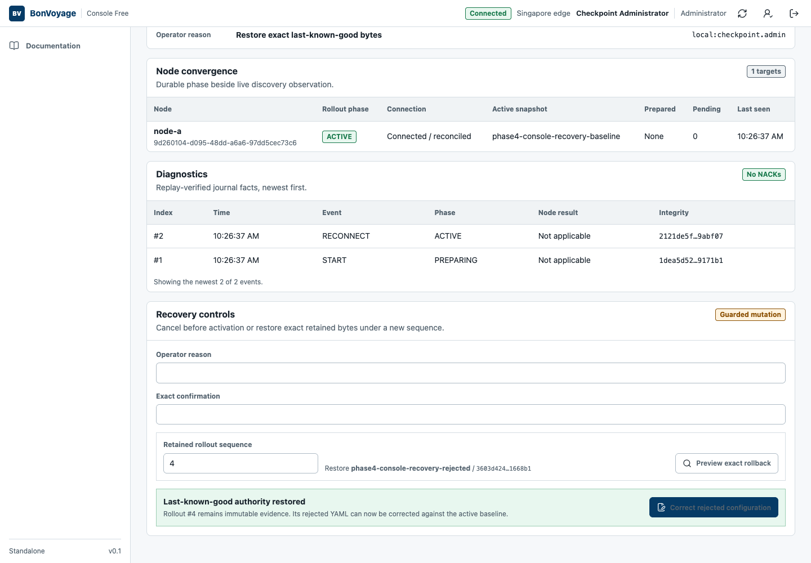
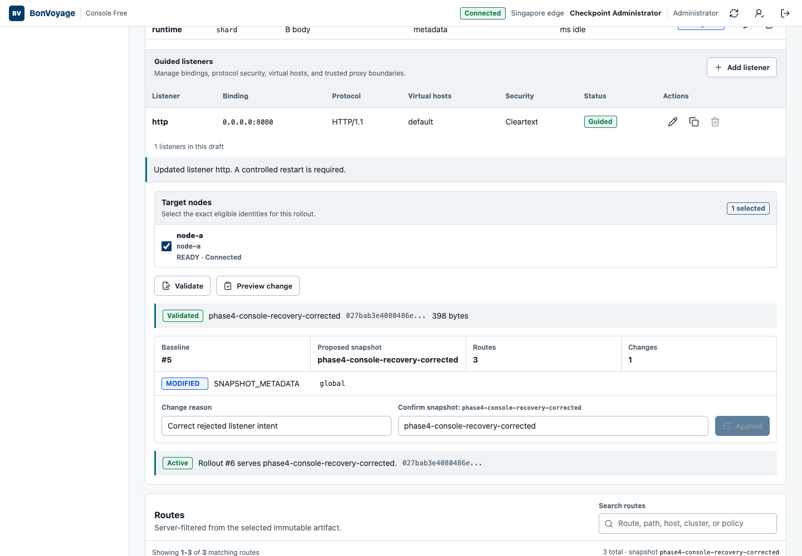

A NACK is a protected outcome: the gateway rejected the proposed artifact and
kept serving the last-known-good snapshot. Do not repeatedly submit the same
proposal.

## 1. Read the diagnostic

Open the rejected rollout and inspect **Diagnostics**. Record the reason code,
field path, target node, operation, and detail.



In this accepted example, `snapshot.listener_restart_required` at
`snapshot.listeners` means the listener address, protocol, or TLS setting
requires a controlled process restart. The node remains connected and reports
the baseline snapshot.

## 2. Verify that traffic stayed on the baseline

Before recovery, run the route check used for the active baseline. A successful
response confirms continuity for that bounded route; it does not prove every
route or policy.

```bash
curl --fail --show-error http://GATEWAY_ADDRESS:GATEWAY_PORT/bonvoyage/ready
```

Escalate rather than roll back blindly if baseline traffic is also failing.

## 3. Preview exact rollback

Under **Recovery controls**:

1. Enter an operator reason.
2. Confirm the retained rollout sequence shown by the Console.
3. Select **Preview exact rollback**.
4. Compare the retained snapshot and artifact digest with the known-good
   baseline.



Type the generated `rollback:REJECTED:BASELINE` confirmation value, then select
**Restore exact artifact**. The Console creates a new monotonic rollout; it does
not rewrite history.



Repeat the baseline traffic check after the rollback.

## 4. Correct the retained proposal

Select **Correct rejected configuration**. The editor loads the rejected
desired state so the invalid intent is visible. Correct only the diagnosed
field, assign a new snapshot identity and generation, then repeat validation,
preview, reason, confirmation, and apply.



For a restart-required listener change, schedule the controlled gateway
replacement instead of changing the proposal merely to suppress the NACK.

## 5. Close the evidence chain

Confirm all of the following:

- the corrected rollout is **ACTIVE** and the target node ACKed it;
- the gateway process identity changed only when a controlled restart was
  intended;
- the route check returns the expected status, body, and headers;
- the rejected diagnostics remain available and unchanged; and
- **Audit** contains paired request and completion outcomes for the rejection,
  rollback, and correction.

The screenshots on this page come from a production Console build connected to
a local control plane, real gateway process, and controlled upstream. The
accepted replay preserved HTTP `200` traffic after the NACK, rollback, and
correction, with zero dataplane restarts during the live-safe recovery path.
