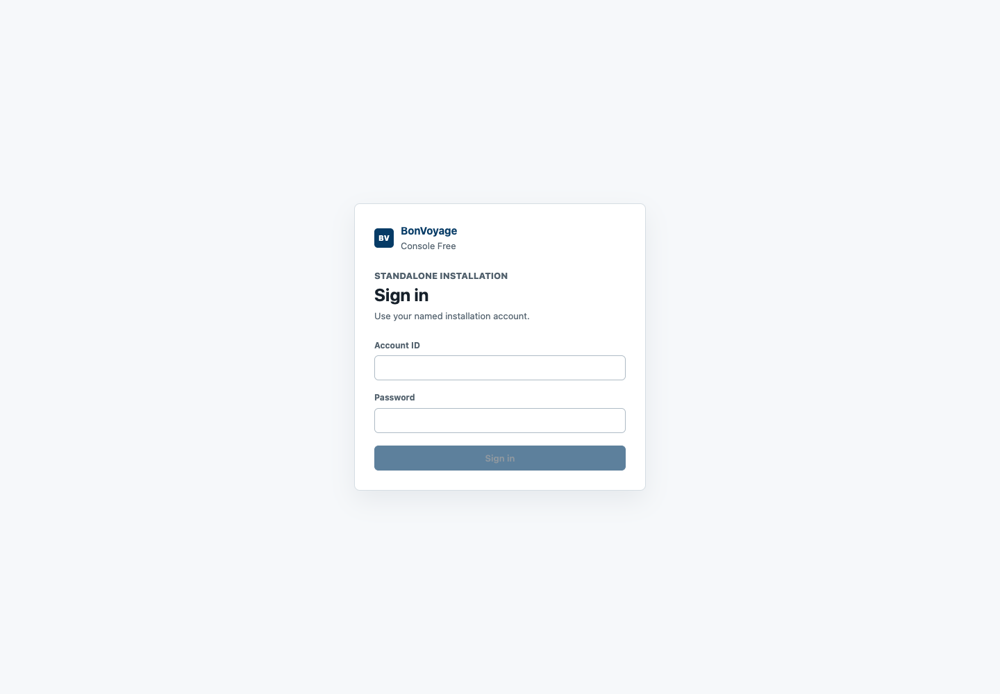

Use this tutorial before proposing a configuration change.

## Prerequisites

- The management plane, Console, and at least one gateway node are running.
- The installation owner has [created a named Console account](../create-first-administrator/).
- You have the Console URL, account ID, and password for that account.
- The account has the role required for the work you intend to perform.

Console Free ships no default account, password, or hidden recovery credential.
Do not try example credentials from development fixtures on an installed system.

Do not share an account or put its password in YAML, shell history, screenshots,
or issue reports.

## 1. Sign in

Open the Console URL supplied by the installation operator. Enter your
**Account ID** and **Password**, then select **Sign in**.

After authentication, the top bar shows the account, role, and management-plane
connection state. A green **Connected** badge means the Console authenticated
to its configured management service. It is not a gateway traffic-health
result or a public management-API compatibility claim.

## 2. Confirm installation authority

Open **Overview** and check:

- **Installation ready** is visible;
- the expected number of gateway nodes is connected and reconciled;
- the active rollout and artifact identify the intended baseline; and
- no command is pending.

Stop and investigate if the active snapshot, node count, role, or installation
identity is not the one you expected.

## 3. Inspect nodes and configuration

Open **Nodes** and confirm that each intended target is connected, reconciled,
and reports the expected process identity. Then open **Configuration** and
review the active snapshot, artifact digest, schema version, routes, clusters,
listeners, and policies.

The active state is authoritative. A draft in the editor is not active until a
rollout completes and the node reports it.

## 4. Leave safely

Use the sign-out icon in the top bar when the session is no longer needed.
Reauthenticate only when a protected operation requires it; do not keep a
privileged session open for convenience.

Next: [Apply a configuration](../apply-configuration/).
