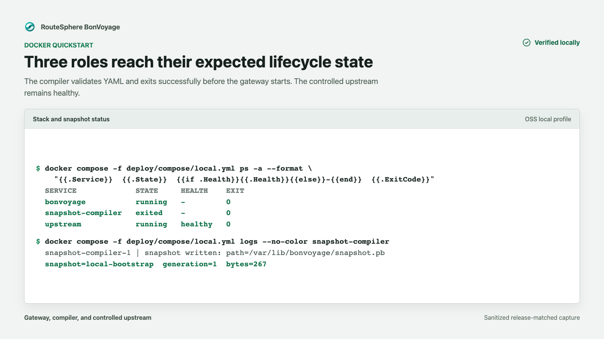

## Start BonVoyage

Run this command from the repository root:

```bash
docker compose -f deploy/compose/local.yml up --build --detach --wait
```

The profile builds and starts three roles:

1. `upstream` returns controlled responses.
2. `snapshot-compiler` validates `config/examples/local.yaml` and writes the
   immutable runtime snapshot.
3. `bonvoyage` loads that snapshot and starts one overprovisioned shard for
   local evaluation.

Wait until the upstream is healthy and the gateway is running.

The evaluation profile binds the traffic, metrics, and admin listeners to
`127.0.0.1`. It is not exposed to the local network by default.

The data-plane image build runs its compiled component test suite before it
emits the minimal runtime image. The snapshot compiler must then exit
successfully before Compose starts the gateway.



The capture shows the expected lifecycle after the release-matched local
profile starts: the compiler completed generation `1`, the upstream is healthy,
and the gateway is running. Relative startup times and container identifiers
are intentionally omitted because they are not deployment invariants.

## Verify traffic

Run the complete bounded check:

```bash
make verify-local-deployment
```

The verifier checks all three role lifecycles, sends 25 fixed and 25 proxied
requests, validates exact request and upstream-selection counter deltas, and
requires zero route misses, 4xx/5xx responses, request timeouts, overload
rejections, upstream failures, allocator failures, abandoned failed futures,
and reactor-stall reports. A successful run ends with `status=pass`.

The following individual commands are useful when diagnosing a failed check.

The example snapshot includes a fixed readiness response:

```bash
curl --fail --show-error http://127.0.0.1:8080/bonvoyage/ready
```

Expected body:

```text
ready
```

Verify that ordinary traffic crosses the listener, route, upstream pool, and
controlled upstream:

```bash
curl --fail --show-error http://127.0.0.1:8080/healthz
```

Expected body:

```text
ok
```

Verify the process-level readiness endpoint separately:

```bash
curl --fail --show-error http://127.0.0.1:9901/health/ready
```

Prometheus metrics are exposed on the metrics listener:

```bash
curl --fail --show-error http://127.0.0.1:9090/metrics
```

These three checks answer different questions: the route check proves request
handling, the admin check proves process readiness, and the metrics check proves
the observability listener is reachable.

Use [Verify a local deployment](/how-to/verify-local-deployment/) when you need
the focused status, log, and metric checks without repeating this tutorial.

## Stop cleanly

```bash
docker compose -f deploy/compose/local.yml down --volumes
```

Removing the named snapshot volume prevents a later evaluation from silently
reusing an older compiled snapshot.

## Troubleshooting

| Symptom | Check |
| --- | --- |
| Build stops during dependency compilation | Confirm Docker has sufficient memory and free disk space. |
| Gateway never becomes ready | Inspect the snapshot compiler result before the gateway logs. Invalid configuration must not activate. |
| Port is already allocated | Stop the conflicting local service or change the host-side mapping for the evaluation. |
| Route responds but metrics do not | Check port `9090` independently; traffic, admin, and metrics listeners have separate roles. |
