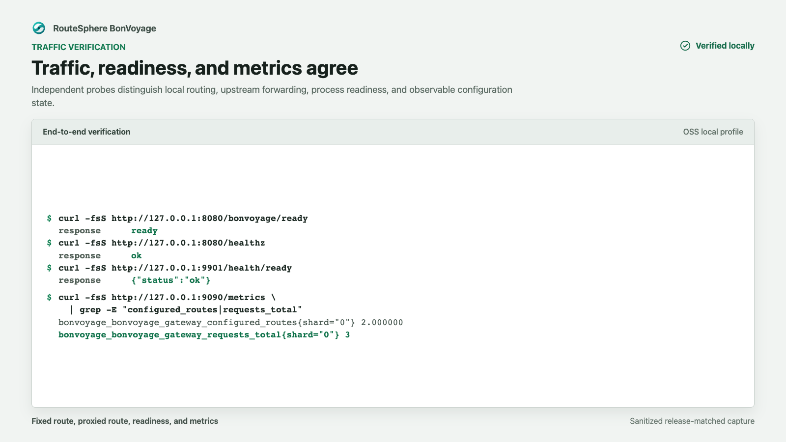

Use these checks after starting the local stack from the
[Docker quickstart](/getting-started/quickstart/).

## Run the bounded verifier

```bash
make verify-local-deployment
```

The command fails closed unless the compiler exited successfully, the upstream
is healthy, the gateway is running, and neither long-running role restarted.
It verifies exact response bodies and then sends 25 fixed-route plus 25
proxied-route requests. The request, 2xx response, and upstream-selection
counters must advance by the exact expected amounts while selected error and
runtime-failure counters remain zero.

Set `BONVOYAGE_VERIFY_REQUESTS_PER_ROUTE` to another positive integer when a
larger bounded sample is useful. This command is a functional acceptance check,
not a capacity benchmark.

Use the individual checks below for diagnosis or independent inspection.

## Check the three roles

```bash
docker compose -f deploy/compose/local.yml ps --all
```

Confirm that:

- `snapshot-compiler` exited with status `0`;
- `upstream` is running and healthy; and
- `bonvoyage` is running.

The compiler is a one-shot role. Its successful exit is expected and proves
that the declarative YAML produced an immutable snapshot before gateway
startup.

## Check local and proxied routes

The fixed route verifies listener, route matching, and response handling:

```bash
curl --fail --show-error http://127.0.0.1:8080/bonvoyage/ready
```

Expected body: `ready`.

The upstream health route additionally verifies upstream selection, connection
handling, and response forwarding:

```bash
curl --fail --show-error http://127.0.0.1:8080/healthz
```

Expected body: `ok`.

## Check process readiness

```bash
curl --fail --show-error http://127.0.0.1:9901/health/ready
```

Expected response:

```json
{"status":"ok"}
```

Readiness is a process and active-state signal. It is separate from application
traffic and should not replace an end-to-end routed request.

## Check configuration and request metrics

```bash
curl --fail --show-error --silent http://127.0.0.1:9090/metrics \
  | grep -E 'gateway_(configured_routes|requests_total)'
```

The local example exposes two configured routes. `requests_total` should
increase after the route checks. Counter values depend on how many probes have
already run, so validate their meaning rather than copying one fixed count.



This release-matched capture used three application requests, so its request
counter is `3`. Your counter may be higher; the required behavior is that the
configured-route gauge is `2` and the request counter advances after traffic.

## Inspect startup evidence

```bash
docker compose -f deploy/compose/local.yml logs \
  snapshot-compiler bonvoyage
```

The compiler log identifies the written snapshot and generation. Treat startup
errors, an absent snapshot, or a nonzero compiler exit as a failed deployment;
do not bypass snapshot validation by reusing an older volume.

## Stop and remove the snapshot volume

```bash
docker compose -f deploy/compose/local.yml down --volumes
```

Removing the volume ensures the next run must compile and activate the current
configuration.
